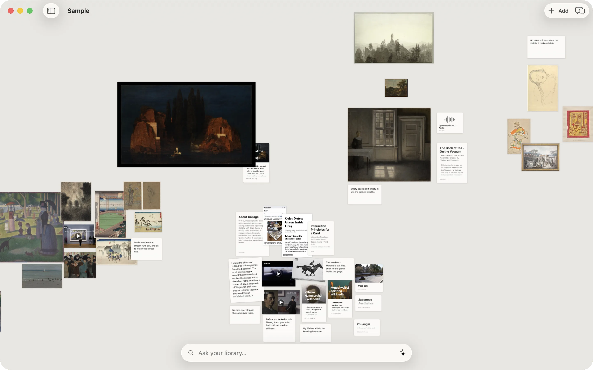
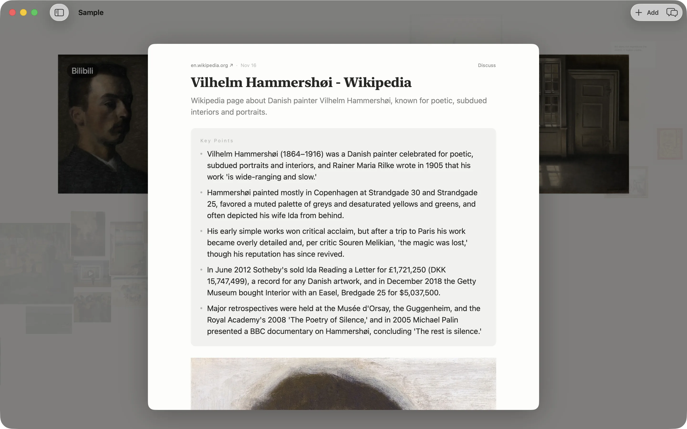
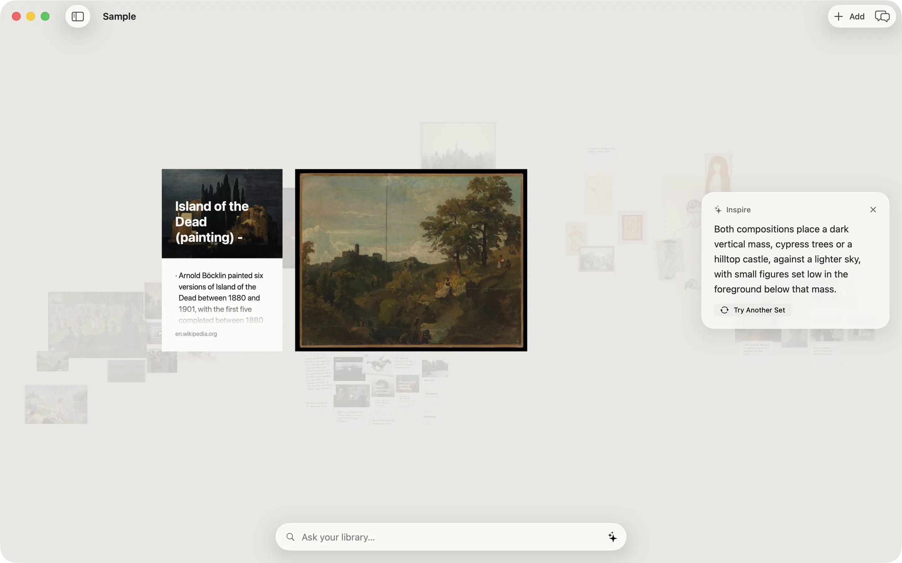
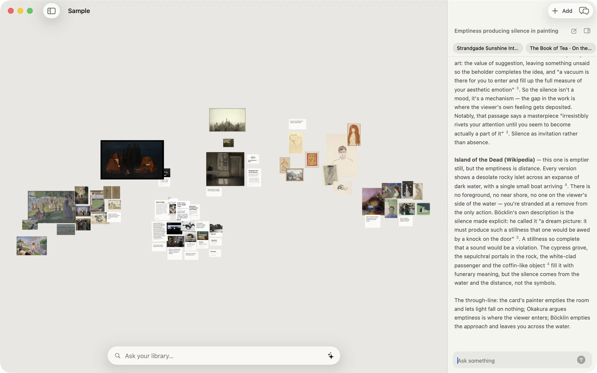

# Piyi

[中文](README.md)

Piyi (片羽, “a fragment of a feather”) turns web pages, images, videos, audio, and documents into cards you lay out freely on boundless boards. To find something, describe it in a sentence and the matching cards come to the front. It is a native macOS app, and your library stays on your own Mac. Requires macOS 26; for now you build it from source.



## Collect

You can collect from anywhere:

- Drag files or links onto a board, or paste them; the cards land on that board.
- Browser extension (Chrome, Edge, Arc): click the Piyi icon in the toolbar to collect the page you are reading, or right-click a page and choose Collect to Piyi.
- In other apps: copy, then press ⌃⌥C; or select text or files, right-click, and choose Services › Collect to Piyi.
- iPhone: share to the “Collect To Piyi” shortcut, which delivers items to your Mac through iCloud Drive.

Cards collected from the browser, other apps, or your phone land in Unsorted first.

Piyi reads what you collect. It pulls the main text out of web pages, including WeChat articles, Weibo, and Xiaohongshu. Bilibili and YouTube videos come with their subtitles; Bilibili subtitles need the browser extension and a Bilibili login in that browser. Audio and video files are transcribed on your Mac, and text in images is recognized. With a cloud model connected, every card also gets a title, a one-line description, key points, and tags.

## Arrange

Cards can be moved, resized, rotated, and cropped (⌘K), so you can group things by size and spacing. The same card can sit on several boards (⌘C, then ⌘V).

Right-click a board in the sidebar and choose Sorting Settings… to give it a one-line rule, such as "references for color and type"; new cards that fit the rule are sorted onto that board automatically. Auto-sort currently needs OpenRouter with its default judging model, plus the local model.

## Find by describing

Search goes by meaning, so you don't need to remember what a card was called or which board it is on. Click into the search field to get filters for date, type, color, and more; in All Cards you can also browse grouped by day, color, or source.


## Open a card

Double-click a card (or press ⌘Y) to open it. Articles open with their key points; click one to jump to the passage it came from. Videos and audio play here, Bilibili and YouTube included, with transcripts split by time; click a line to play from that moment.



## Think with it

Inspire: click ✦ at the right of the search field. Piyi picks a few cards from the current board and names one concrete connection between them. Click Try Another Set for a different pick.



Discuss: click the speech-bubble icon at the top right to open the discussion panel. Type @ to bring a few cards into the conversation and ask about them, or ask about your whole library and let it find the relevant cards itself. Citations appear as small gray numbers; hover to see the quoted text and its source, click to open that passage. Discussions stay in the sidebar and are archived after three days without activity.



## Install

There is no prebuilt download yet, so build from source. You need macOS 26 or later, Xcode 26, and Node.js (to build the browser extension). If the command line still points at the standalone Command Line Tools, run `sudo xcode-select -s /Applications/Xcode.app` first:

```sh
git clone https://github.com/Zhihao-R/piyi.git
cd piyi
./scripts/build_app.sh
```

The app is written to `build/Piyi.app`. Drag it into your Applications folder.

## First launch

Piyi opens on a Sample board whose cards already have descriptions and key points, so you can browse them without an API key. Setup then walks through four steps; each can be skipped and finished later in Settings:

1. Connect a cloud model. Pick a provider and paste its API key. Built in are OpenRouter, DeepSeek, Volcano Engine, Alibaba Cloud Model Studio, SiliconFlow, Zhipu GLM, Kimi, MiniMax, Anthropic, Gemini, and OpenAI, plus any other OpenAI-compatible endpoint. Without one you can still collect and arrange, but new cards get no title, description, key points, or tags, nothing is auto-sorted, and Inspire and Discuss are unavailable.
2. Download the local model (about 600 MB). Search runs on it and works offline once downloaded.
3. Install the browser extension. Follow the steps to load the extension bundled with the app from your browser's extensions page. Piyi also uses it to open pages that need a login or load through scripts, in the background.
4. Collect from your phone. Add the “Collect To Piyi” shortcut on your iPhone; your iPhone and Mac must be signed in to the same Apple Account, with iCloud Drive turned on on your Mac.

## Where your data lives and what leaves your Mac

The library is in `~/Library/Application Support/Piyi/`: cards, original files, thumbnails, and API keys. The local search model, transcription, and text recognition in images all run on your Mac.

With a cloud model connected, these send card or page content to the provider you chose: writing titles, descriptions, key points, and tags; understanding your search and ranking the cards it finds; auto-sort; checking whether a fetched page is the article or a login page, and extracting the text when the page can't be read directly; Inspire and Discuss. Without a cloud model, nothing is sent.

## Keyboard shortcuts

| Keys | Action |
|---|---|
| ⌘N | New board |
| ⌘F | Search |
| ⌘0 | Show the whole board |
| ⌘Y | Open the selected card |
| ⌘K | Crop |
| ⌘C, ⌘V | Put cards on another board |
| ⇧⌘A | Arrange the selected cards in rows |
| ⌘[ | Back |
| ⌘Z | Undo; each board keeps its own history |
| ⌃⌥C | Collect what you just copied, from any app |

## Contributing

Building, the code layout, translations, and how the sample board is generated are covered in [CONTRIBUTING.md](CONTRIBUTING.md) (in Chinese).

## License

The code is released under the [MIT License](LICENSE). The artworks and texts on the sample board come from public-domain or openly licensed sources; per-item credits and the licenses of third-party code are listed in [THIRD_PARTY_NOTICES.md](THIRD_PARTY_NOTICES.md).
