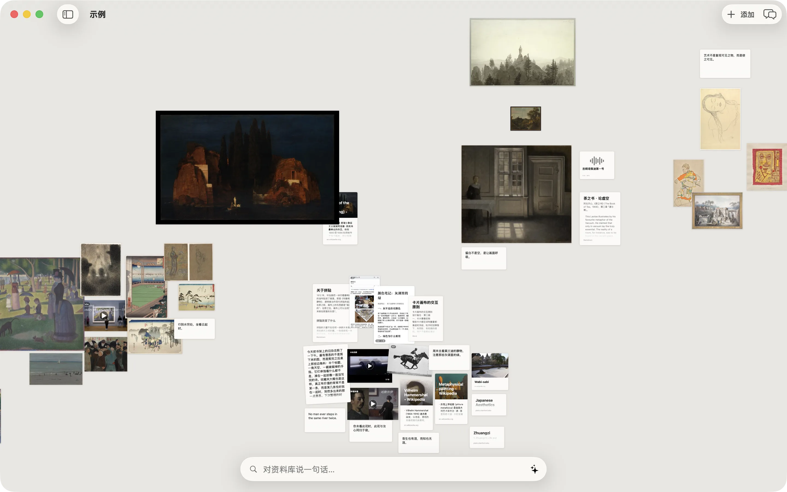
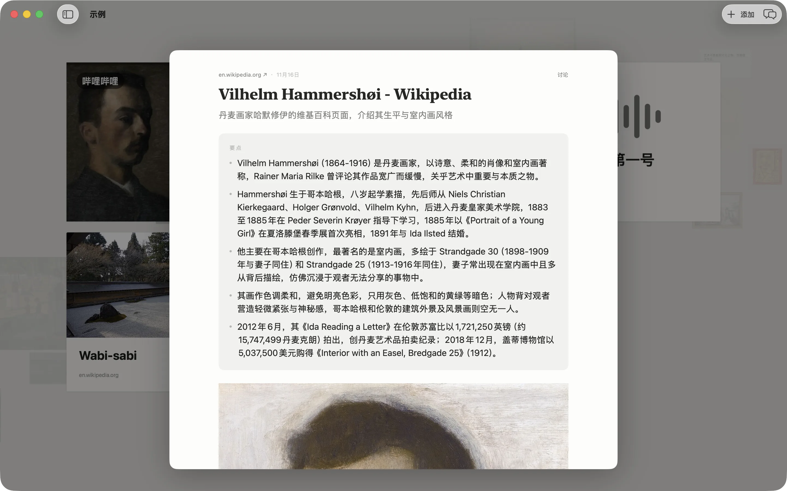
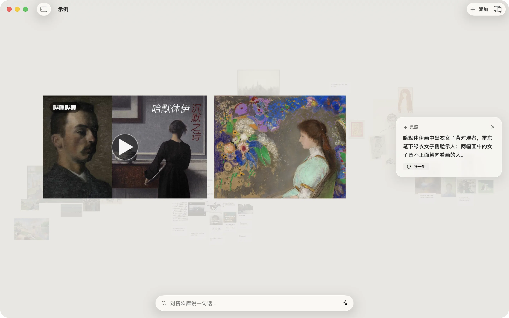
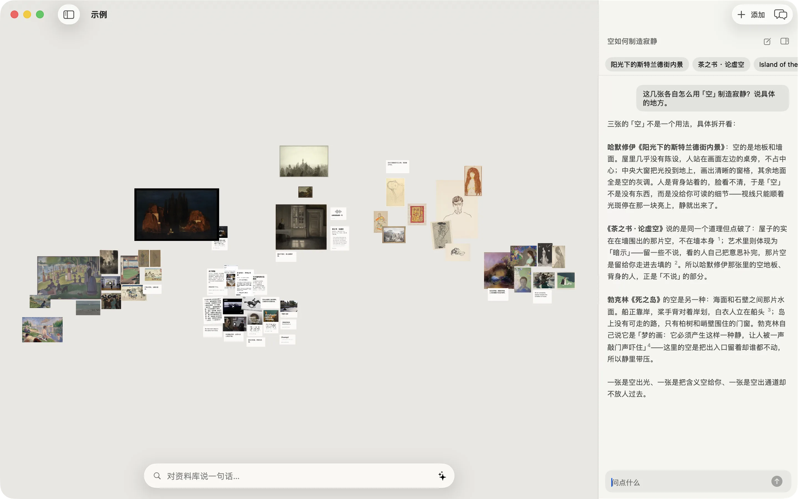

# 拼贴

[English](README.en.md)

拼贴把网页、图片、视频、音频和文档收成卡片，摊在没有边界的画板上自由摆放。想找什么，对资料库说一句话，相关的卡就聚到眼前。它是 macOS 原生 App，资料都存在你自己的电脑上。需要 macOS 26，目前要从源码编译。



## 收进来

在哪看到都能收：

- 往画板上拖文件、网址，或者直接粘贴，卡片就放在这个画板上。
- 浏览器扩展（Chrome、Edge、Arc）：点工具栏上的拼贴图标收下正在看的网页，或在网页上右键「收进拼贴」。
- 其他 App 里：复制后按 ⌃⌥C；或者选中文字、文件后右键「服务」›「收进拼贴」。
- iPhone：分享到「收集拼贴」快捷指令，内容经 iCloud 云盘送到 Mac。

从浏览器、其他 App 和手机收进来的卡，先放在「未归类」。

收进来的东西会被读懂。网页取正文，公众号、微博、小红书也能取；B 站和 YouTube 的视频带上字幕，B 站的字幕要装了浏览器扩展、并在浏览器里登录 B 站才取得到；音视频文件在本机转录成文字；图片里的字会被识别出来。接入云端模型后，每张卡还会配上标题、一句话描述、要点和标签。

## 摆在画板上

卡片可以拖动、缩放、旋转、裁剪（⌘K），用大小和疏密把一组东西摆出关系。同一张卡可以放进好几个画板（⌘C 再 ⌘V）。

在侧边栏右键画板，选「分拣设置…」写一句规则，比如「配色和字体相关的参考」，新收的卡符合规则就会自动分进这个画板。自动分拣目前要用 OpenRouter 和它默认的判断模型，还要下载本机模型。

## 用一句话找回来

搜索按意思找，不用记卡片叫什么、放在哪个画板。点进搜索框，上方会出现时间、类型、颜色等筛选；在「全部卡片」里还能按天、按颜色、按来源分组浏览。


## 放大查看

双击卡片（或按 ⌘Y）放大查看。文章先给要点，点一条要点跳到原文对应的段落。视频和音频在这里播放，B 站和 YouTube 的视频也一样；字幕按时间分段，点一句就从那一秒开始播。



## 让它帮你想

灵感：点搜索框右边的 ✦，它从当前画板挑几张卡，说出它们之间的一个具体联系。不满意就点「换一组」。



讨论：点右上角的对话图标打开讨论栏。可以在输入框里打 @ 挑几张卡放上来，就它们提问；也可以直接问整个资料库，它会自己去找相关的卡。回答里的引用标成灰色小数字，鼠标停上去能看到原话和出处，点一下打开原文那一段。讨论留在侧边栏，三天没动就自动归档。



## 安装

目前还没有打包好的下载版，需要从源码编译。要求 macOS 26 以上、Xcode 26，以及用来编译浏览器扩展的 Node.js：

```sh
git clone https://github.com/Zhihao-R/piyi.git
cd piyi
./scripts/build_app.sh
```

编译好的 App 在 `build/拼贴.app`，拖进「应用程序」文件夹就能用。

## 第一次打开

打开后有一块「示例」画板，里面的卡已经配好了描述和要点，不填密钥也能翻看。随后的引导有四步，每一步都可以跳过，以后在设置里补：

1. 接入云端模型。选一家服务商，填它的密钥。内置 OpenRouter、DeepSeek、火山引擎、阿里云百炼、硅基流动、智谱 GLM、Kimi、MiniMax、Anthropic、Gemini、OpenAI，也可以填其他兼容 OpenAI 接口的地址。不接的话照样能收集和摆放，只是新卡没有标题、描述、要点和标签，不会自动分拣，灵感和讨论也用不了。
2. 下载本机模型（约 600 MB）。搜索靠它，下载一次之后离线可用。
3. 装上浏览器扩展。照引导在浏览器的扩展页里加载 App 自带的扩展。需要登录、靠脚本加载的网页，拼贴也会交给扩展在后台打开。
4. 从手机收集。在 iPhone 上添加「收集拼贴」快捷指令，iPhone 和 Mac 须登录同一个 Apple 账户，且 Mac 开着 iCloud 云盘。

## 资料存在哪，什么会发出去

资料库在 `~/Library/Application Support/Collage/`，卡片、原文件、缩略图和密钥都在这里。搜索用的本机模型、音视频转录和图片识字都在本机运行。

接入云端模型后，下面这些事会把卡片或网页内容发给你选的那家服务商：生成标题、描述、要点和标签；搜索时理解你那句话、给找到的卡按相关程度排序；自动分拣；判断抓回来的网页是正文还是登录页，认不出正文时代为提取；灵感和讨论。不接云端模型时，什么都不会发出去。

## 快捷键

| 按键 | 作用 |
|---|---|
| ⌘N | 新建画板 |
| ⌘F | 搜索 |
| ⌘0 | 回到全景，看到画板上所有的卡 |
| ⌘Y | 放大查看选中的卡 |
| ⌘K | 裁剪 |
| ⌘C、⌘V | 把卡放进另一个画板 |
| ⇧⌘A | 把选中的卡整理成行 |
| ⌘[ | 后退 |
| ⌘Z | 撤销，每个画板各有一条撤销记录 |
| ⌃⌥C | 在任何 App 里，把刚复制的东西收进拼贴 |

## 参与开发

编译调试、代码分块、界面翻译和示例画板的生成流程见 [CONTRIBUTING.md](CONTRIBUTING.md)。

## 许可证

代码按 [MIT 许可证](LICENSE)开源。示例画板里的画作和文字来自公有领域或开放许可的来源，逐项出处和所用第三方代码的许可见 [THIRD_PARTY_NOTICES.md](THIRD_PARTY_NOTICES.md)。
