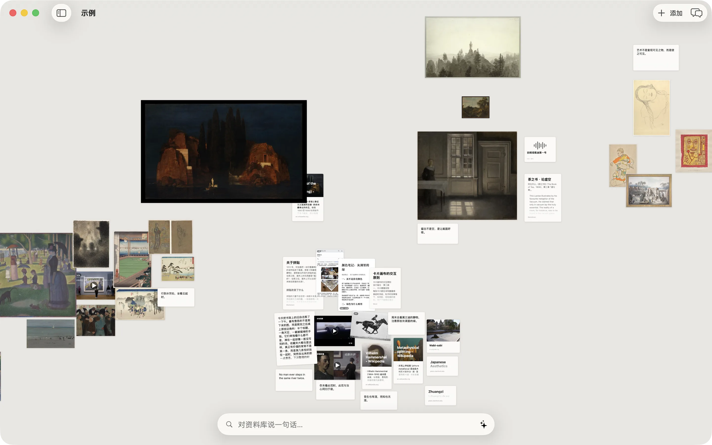
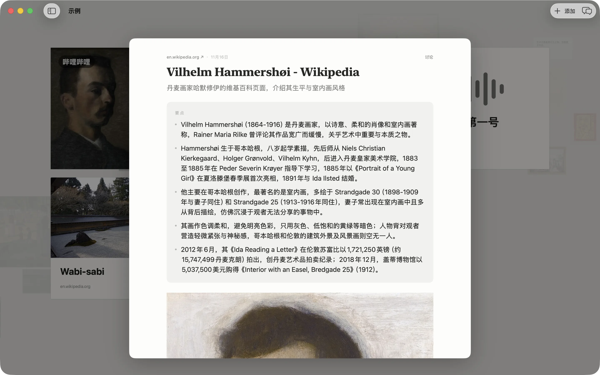
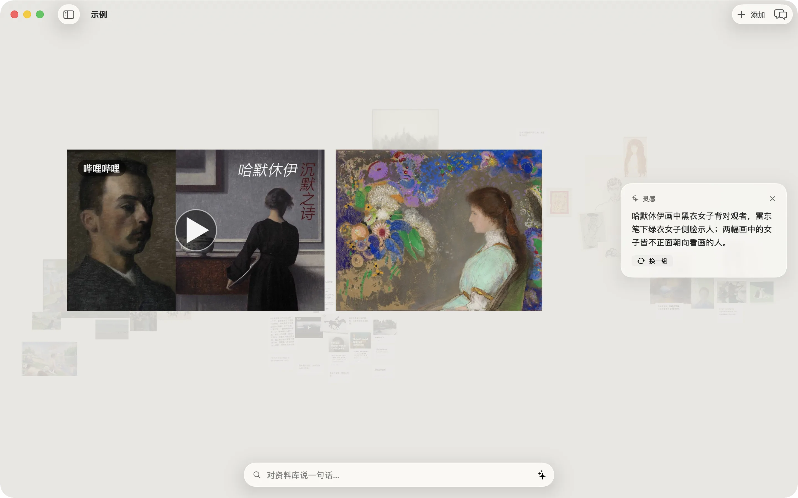
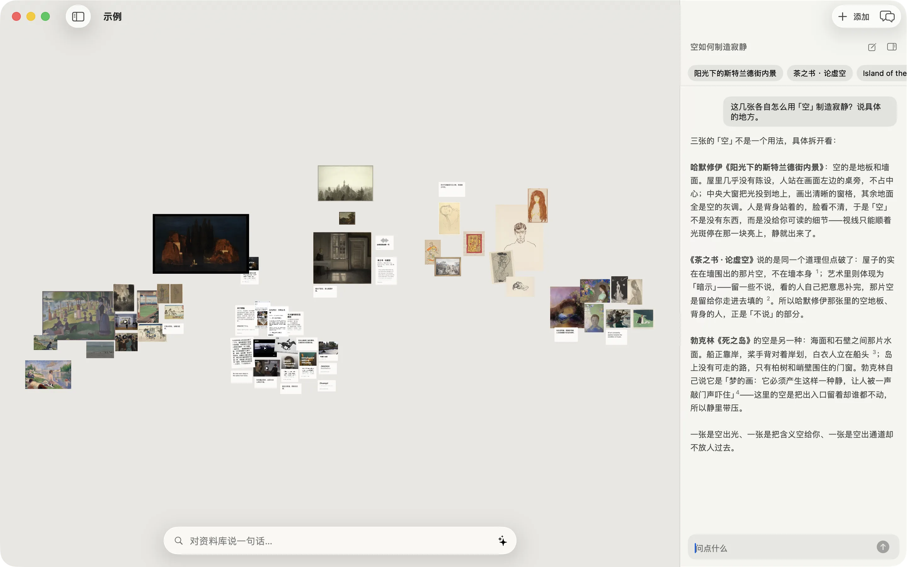

# 片羽

[English](README.md)

片羽是 macOS 上的视觉素材库：网页、图片、视频、音频和文档收进来成为卡片，在无边界的画板上自由排布；查找时用一句话描述，相关卡片即聚拢到眼前。资料全部存于本机。需要 macOS 26，目前须从源码编译。



## 收集

| 来源 | 方式 |
|---|---|
| 文件、网址 | 拖入或粘贴到画板，卡片落在当前画板 |
| 浏览器（Chrome、Edge、Arc） | 点击工具栏中的片羽图标收录当前网页，或在网页上右键选择「收进片羽」 |
| 其他 App | 复制后按 ⌃⌥C；或选中文字、文件后右键选择「服务」›「收进片羽」 |
| iPhone | 分享到「Collect To Piyi」快捷指令，经 iCloud 云盘同步到 Mac |

从浏览器、其他 App 和手机收录的卡片先进入「未归类」。

收录后，片羽提取内容：网页取正文，含公众号、微博、小红书；B 站和 YouTube 视频附带字幕，其中 B 站字幕需安装浏览器扩展并在该浏览器中登录 B 站；音视频文件在本机转录；图片中的文字自动识别。接入云端模型后，每张卡片另生成标题、一句话描述、要点和标签。

## 画板

卡片可拖动、缩放、旋转和裁剪（⌘K），借大小与疏密表达一组素材之间的关系。同一张卡片可放入多个画板（⌘C、⌘V）。

画板可设置分拣规则：在侧边栏右键画板，选择「分拣设置…」，写一句描述，例如「配色和字体相关的参考」，此后新收录且符合规则的卡片自动归入该画板。自动分拣目前依赖 OpenRouter 及其默认判断模型，并需下载本机模型。

## 搜索

搜索按语义匹配，无需记得卡片名称或所在画板。点击搜索框后，上方出现时间、类型、颜色等筛选；「全部卡片」还可按日期、颜色、来源分组浏览。


## 放大查看

双击卡片或按 ⌘Y 放大查看。文章首先列出要点，点击要点跳转至原文对应段落。视频和音频（含 B 站、YouTube）在此播放，字幕按时间分段，点击任一句从该处播放。



## 灵感与讨论

灵感：点击搜索框右侧的 ✦，片羽从当前画板选出几张卡片，指出它们之间的一处具体联系；点击「换一组」重新选择。



讨论：点击右上角的对话图标打开讨论栏。输入 @ 可指定若干卡片作为讨论对象；也可直接就整个资料库提问，由模型自行检索相关卡片。回答中的引用以灰色小号数字标注，悬停显示原文与出处，点击打开原文对应段落。讨论保存在侧边栏，三天无新消息即自动归档。



## 安装

目前没有预编译版本，须从源码编译。环境要求：macOS 26 及以上、Xcode 26 的 Command Line Tools（`xcode-select --install`），以及用于编译浏览器扩展的 Node.js。完整的 Xcode 不是必需的：装了 Xcode，App 图标带系统的玻璃质感；没装则使用同一图标的普通版本。若已装 Xcode 但命令行仍指向独立的 Command Line Tools，先执行 `sudo xcode-select -s /Applications/Xcode.app`。

```sh
git clone https://github.com/Zhihao-R/piyi.git
cd piyi
./scripts/build_app.sh
```

编译产物为 `build/Piyi.app`，移入「应用程序」文件夹即可使用。

## 首次启动

首次启动会打开「示例」画板，其中卡片已附描述和要点，未配置密钥也可浏览。随后的引导共四步，均可跳过，日后在设置中补全：

1. 接入云端模型：选择服务商并填写密钥。内置 OpenRouter、DeepSeek、火山引擎、阿里云百炼、硅基流动、智谱 GLM、Kimi、MiniMax、Anthropic、Gemini、OpenAI，也支持其他兼容 OpenAI 接口的地址。未接入时仍可收集和排布，但新卡片没有标题、描述、要点和标签，无法自动分拣，灵感与讨论不可用。
2. 下载本机模型（约 600 MB）：搜索依赖此模型，下载后可离线使用。
3. 安装浏览器扩展：按引导在浏览器扩展页加载 App 自带的扩展。需要登录或依赖脚本加载的网页，片羽也通过扩展在后台打开。
4. 从手机收集：在 iPhone 上添加「Collect To Piyi」快捷指令。iPhone 与 Mac 须登录同一 Apple 账户，且 Mac 已开启 iCloud 云盘。

## 语言

界面提供简体中文和英文，默认跟随系统语言，可在「设置 › 语言」中更改。标题、描述、标签、要点和灵感使用界面语言；讨论与搜索提问则以提问所用的语言作答。

AI 生成文字的写作风格可在「设置 › 云端模型 › 详细设置」中调整，标题与标签、要点、讨论、搜索提问、随机抽卡和灵感各自独立。输出格式、出处标注和语言保持不变。

## 数据与隐私

资料库位于 `~/Library/Application Support/Piyi/`，包括卡片、原文件、缩略图和密钥。本机搜索模型、音视频转录和图片文字识别均在本机运行。

接入云端模型后，以下操作会将卡片或网页内容发送给所选服务商：生成标题、描述、要点和标签；解析搜索语句并对结果排序；自动分拣；判断抓取的网页是正文还是登录页，并在无法直接识别正文时代为提取；灵感与讨论。未接入云端模型时，不发送任何内容。

## 快捷键

| 按键 | 作用 |
|---|---|
| ⌘N | 新建画板 |
| ⌘F | 搜索 |
| ⌘0 | 显示画板全部卡片 |
| ⌘Y | 放大查看所选卡片 |
| ⌘K | 裁剪 |
| ⌘C、⌘V | 将卡片放入另一画板 |
| ⇧⌘A | 将所选卡片按行整理 |
| ⌘[ | 后退 |
| ⌘Z | 撤销，各画板的撤销记录相互独立 |
| ⌃⌥C | 在任意 App 中收录刚复制的内容 |

## 参与开发

编译调试、代码分块、界面翻译和示例画板的生成流程见 [CONTRIBUTING.zh-CN.md](CONTRIBUTING.zh-CN.md)。

## 许可证

代码以 [MIT 许可证](LICENSE)发布。示例画板中的画作和文字来自公有领域或开放许可来源，逐项出处及第三方代码许可见 [THIRD_PARTY_NOTICES.zh-CN.md](THIRD_PARTY_NOTICES.zh-CN.md)。
